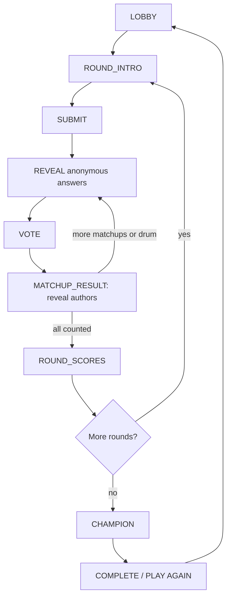

# ECKY THUMP v2.0.0 — Social Club (Step 1 Design)

**Status: PLANNED, NOT IMPLEMENTED.** This design follows the uploaded Premium Review & Rebuild Plan dated 23 October 2026. Uploaded source is actually v1.8.3, not the v1.8.2 used for the original review. No production functionality changes in Step 1.

## Baseline / non-negotiables
- Node 22.16.0 local baseline: **144/144 tests passed**. Preserve native HTTP+SSE, zero runtime dependencies, session-token authority, 3–12 invited players, up to 30 audience, optional independent TVs across one to three homes.
- Preserve all avatar files, identifiers, mappings and their SHA-256 test unchanged. Keep UK English and internal legacy ECKEY identifiers needed for compatibility.
- Game Cards remain **off by default**. Real-device multiplayer and subjective comedy tests remain deferred until **November 2026**.
- The current HTTPS URL **https://ecky-thump.onrender.com** is already correctly spelt. Do not rename it because the older review says otherwise.

## Identity and format
- Setting: Saturday night at the ECKY THUMP Social Club. Stage neon + a Northern club atmosphere, not a brand new asset set.
- Official name: **ECKY THUMP**; one tagline: **Good friends. Terrible answers.**
- Visible humour levels: **FAMILY / CHEEKY / AFTER DARK (18+)**. Internal compatible keys: clean/cheeky/adult. Keep affirmative adult consent and host moderation.
- Quick: Meat Raffle / The Turn / Last Orders (3 rounds). Standard: add Crossed Wires and The Hard Sell (5). Long: an extra Turn (6).

## Server-authoritative phase sequence

Last Orders is a finale *round type*, not a bypass of the above flow. Pauses freeze server deadlines. Every action is validated against authoritative phase, vote token, role and phase deadline. Never leak author identities before MATCHUP_RESULT.

## Pairings and points
- For **N >= 3** entrants in a seeded/shuffled circular order: matchup/prompt i is assigned to entrants i and (i+1) modulo N. Consequently N matchups, N distinct prompts, exactly two per entrant, no same-player pairing and no repeated opponent pair within a single round.
- Eligible A/B voters exclude both contestants in the current matchup. One locked, idempotent ballot each. Up to 15 seconds per vote, closing early when all eligible ballots arrive.
- Each A/B matchup splits a 1,000-point pool by weighted vote share with deterministic integer rounding. No votes: award 0. One valid answer vs no-show: walkover 1,000 to valid answer; no-show 0. Two no-shows: 0 each.
- **ECKY THUMP!** +250 if one entry takes all ballots and at least two distinct eligible people have voted. In 3-player head-to-head, the sole noncompeting player alone cannot earn a cheap unanimity bonus.
- Audience voters together add at most two ordinary player-vote equivalents (proposed weighting: minimum of 2 and number of audience ballots divided by 3); keep ballots private and never permit spectator control of game state.
- Meat Raffle / Last Orders: one player vote for another entry, 300 points per vote, ×2 for Last Orders. At 9–12 players, use two reveal drums of up to six entries and propose **one vote per drum** because unopened entries cannot be judged.

## Conflicts to settle at the Step 2 gate
1. The proposed **one vote per drum** makes two ballots per player for larger lobbies, while the source calls for one vote per player. Choose explicitly.
2. Confirm audience weighting and whether audience individuals contribute to the two-person unanimity threshold.
3. Approve the rule that zero ballots awards zero points and that no-show walkovers take the entire 1,000-point pool.
4. At 12 players, three writing rounds produce **36 matchups**; just the maximum 15-second vote windows total 9 minutes. Thus 20–25 minutes is an unproven target, not a guarantee. Retain early-close votes and test session time in November.
5. The plan's example of a Facebook joke contradicts its 'no company names' rule. Use generic community-group phrasing.
6. 500 Family cards cannot prevent repeats across unlimited 12-player matches if 84 cards are drawn per Card Clash. Track deck exhaustion and set an explicit session capacity.

## Technical build order and file-by-file responsibilities
| Step | Files | Purpose |
| --- | --- | --- |
| **1 — Design (this PR)** | `DESIGN.md` | This document; stage gate. No gameplay code changes. |
| **2 — Engine + persistence** | `server/game.js`, `server/index.js`, `server/content.js`, `server/telemetry.js`; new `server/matchups.js`, `server/scoring-v2.js`, `server/persistence.js`, `server/premium-config.js`, `test/v2-*.test.js` | Phase machine, private role snapshots, pairings, ballots, 1,000-point scores, audiences, room JSON snapshots, origin/rate security, restart tests. |
| **3 — TV** | `public/tv/index.html`, `public/assets/tv.js`, new `public/assets/tv-stage.js`, `public/assets/reveal-stage.js`, `public/assets/shared-ui.js`, CSS | Anonymous large reveals, matchups, vote bars, author celebration, readable 720p/1080p stage. |
| **4 — Phone** | `public/index.html`, `public/assets/app.js`, new `public/assets/phone-controller.js`, `phone-lobby.js`, `phone-vote.js`, `shared-ui.js` | Single-task screens, two written prompts per player, accessible buttons, house cards, connected/disconnected state. |
| **5 — Compère** | `server/packs/voice-lines.json`, `public/assets/compere.js`, `VOICE-LINES.md`, sound files/`show-sfx.js` | Configurable Our Maureen, 60 original lines (<12 words), 3+ variants/event, captions regardless of audio, optional local audio. |
| **6 — Content** | `server/packs/social-club-v2.json`, `server/content.js`, CSV rewrite ledger, tests, review UI | Review **batches of 100** with draft status until user approval. Responses <=45 chars and no colons, prompts <=90 chars, one blank, repeats <=3, rating safeguards. |
| **7 — Six opt-in cards** | `server/game-cards.js`, new v2 pack, TV & phone Game Card UI | Six TV-first powers, one card held/played max, Last Orders score unaffected. |
| **8 — Final consolidation** | one token-based CSS, modular JS, `README.md`, `CHANGELOG.md`, `DESIGN.md`, `VOICE-LINES.md`, `render.yaml`, `.github/workflows/tests.yml`, archive older docs | CI, no unused CSS, correct UK English/version, always-on paid-host directions, final v2.0.0 ZIP. |

## Persistence/privacy
- One active server instance; a filesystem snapshot is **not** a distributed database.
- Save as private atomic JSON under configured `ROOM_DATA_DIR` (production `/data/rooms`) on phase changes and every 5 seconds while active. Encode and restore `Map`/`Set`; validate schema, room age (<6 hours) and hash-bearing sessions. Persist only hashed bearer secrets, never raw tokens.
- Use restrictive file permissions and clear room-data retention/deletion. House Cards are room-only, including any temporary restart snapshot; no global reuse of private jokes. Timer recovery must reconcile absolute expiry and pauses.
- No persistence functionality is present yet. Retain current in-memory rooms until implementation and restart tests prove recovery. Do not deploy during active games.

## Acceptance and validation
- Baseline `npm test`: 144 passed; zero failed. Also run `npm run audit:content` and `npm run review:content`; all **1,200 expansion entries remain draft**, despite a clean structural audit.
- Required new tests: assignment for 3–12; repeated-vote/idempotency; no-self-vote; role secrecy; no-show; audience cap/unanimity; pause/restart restore; room expiry; content syntax/uniqueness/repetition; rated content; avatar integrity; HTTP security.
- Host/user-device acceptance, actual 20–25 minute pacing, laughter, TV readability and fairness all remain **unverified** until November 2026.
- Follow the source document's explicit **STOP after each step** rule. Step 2 implementation requires this Step 1 design gate to be resolved. Keep changes isolated from main/Render until fully tested.