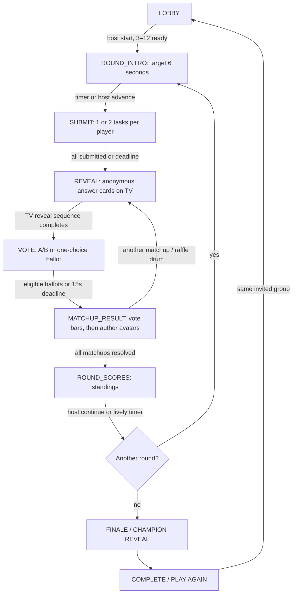

# ECKY THUMP v2.0.0 — Social Club
## Step 1: Authoritative implementation plan and engine contract

**Prepared:** 23 October 2026
**Inputs:** `ECKY-THUMP-main.zip` (actual v1.8.3) and `ECKY-THUMP-Premium-Plan.md` (reviewed v1.8.2)
**Status:** Step 1 prepared; **no v2 gameplay changes merged or deployed**. The plan expressly requires approval between steps.
**User testing:** real-device multiplayer testing remains deferred until November 2026.

## 1. Baseline verified

- Uploaded `package.json`: `1.8.3`; Node v22.16.0; `npm test`: **144 tests, 144 passed, 0 failed** (5.5 seconds in this environment).
- Live architecture: Node built-in HTTP + REST + SSE; no runtime dependencies; server-authoritative scoring; 3–12 players and up to 30 audience members; client-side seat recovery while the same process survives.
- The ZIP contains the existing v1.8.3 TV bearer-token and SSE fixes. These supersede the older observations in the review. The current Render URL is already correctly spelt `https://ecky-thump.onrender.com`; do **not** try to rename an already-correct URL.
- The 1,200-entry After Dark expansion includes 720 `responses`, of which **357 contain a colon**, **290 have >70 characters**, **481 exceed the proposed 45-character cap**. All 1,200 expansion entries are `draft`. **12 distinct four-word response openings occur more than three times; the worst occurs 30 times.** These are catalogue measurements, not human humour verdicts.
- Existing five challenge types remain `CARD`, `WIT`, `CONTEXT`, `DOUBLE`, `FINAL` in the engine. Existing Gold/Silver scoring and Game Cards are **not compatible** with the proposed v2 match scoring; retain the v1.8.3 implementation as a working baseline until replacement engine tests pass.
- All avatar images, IDs, mappings and the baseline-verification test are a **hard no-edit boundary**.

## 2. Product direction and non-negotiables

**Premise:** Saturday night at the **ECKY THUMP Social Club**. Keep the premium neon, but put it on a recognisably Northern cabaret stage with club motifs; do not throw away existing art.

**One official name:** ECKY THUMP.
**One tagline:** Good friends. Terrible answers.
**Player-facing content levels:** FAMILY / CHEEKY / AFTER DARK (18+).
**Internal compatibility values:** `clean`, `cheeky`, `adult` must continue to map to the above until all callers and old lobby/session data have been migrated. Existing `ECKEY_*` JavaScript API identifiers stay unchanged where needed for compatibility.

Keep: 3–12 invited players, remote two- to three-household hosting, optional independent TV screens, phone-only play, anonymous authors until scoring, reconnectable seats, host moderation, UK English, opt-in audio, keyboard and reduced-motion accessibility, and zero runtime dependencies. Stage the update away from the `main` production branch.

## 3. Phases and state machine



`FINALE` is a challenge type / themed title, **not an independently selectable server phase**: the finale uses `ROUND_INTRO → SUBMIT → REVEAL → VOTE → MATCHUP_RESULT → ROUND_SCORES` like the other rounds, with its ×2 base multiplier. A short `CHAMPION` presentation can be either its own phase or the first view in `COMPLETE`; prefer a distinct `CHAMPION` phase so the host controls the applause moment.

A phase change is an **idempotent, authoritative state transition**. Each state includes `phaseStartedAt`, `deadline` (or null for host-controlled pauses), `revision`, `roundIndex`, `matchupIndex` / drum index and a stable token for the current vote. Timed transitions and user actions must be checked against the **server clock**, not the client clock. Replayed actions after an interval restart do not duplicate points.

### Private snapshots per role

- **Phone contestant:** private prompts/tasks, own answer/card hand, current ballot eligibility, submit/vote acknowledgement, host controls if host. Never another contestant's private assignment or author identity before matchup result.
- **TV:** approved current phase, public submissions count, current anonymous reveal and vote bars, then author avatars only after vote close. Never secrets, unsubmitted answers or token hashes.
- **Audience:** read-only public reveal and small permitted audience ballot; no private hands or host controls.

## 4. Match structure and scoring contract

| Lobby length | v2 playlist | Design intent |
|---|---|---|
| Quick | Meat Raffle → The Turn → Last Orders | Three rounds |
| Standard | Meat Raffle → The Turn → Crossed Wires → The Hard Sell → Last Orders | Five rounds |
| Long | Meat Raffle → The Turn → Crossed Wires → The Hard Sell → The Turn II → Last Orders | Six rounds |

Retain machine-readable codes `CARD`, `WIT`, `CONTEXT`, `DOUBLE`, `FINAL` internally, and expose a display label and short rule for each.

**Head-to-head schedule (WIT, CONTEXT, DOUBLE):** for `N` players indexed in shuffled/seeded order `0..N−1`, prompt/matchup `i` is assigned to players `i` and `(i+1) mod N`. Each prompt goes to **two different** players; each player gets **two distinct** prompts; no pair repeats within a round for `N≥3`. An `N=3` room yields 3 distinct pairings, and `N=12` yields 12. Rotate/shuffle initial order between rounds to diversify opponents. Do not construct assignments independently on the clients.

**Head-to-head ballots:** only players *not* in the active pair may vote A/B. Vote windows are at most 15s; early close when all eligible votes arrive. A submitted ballot is immutable and idempotent on exact retry. Each eligible voter has one ballot for this matchup, not per round.

**Point rule:** a matchup has a **1,000-point pool**, split by eligible weighted vote share, using a deterministic integer rule (e.g. floor for A, remainder for B). If no eligible ballots arrive, the pool is **not awarded**; otherwise a no-show earns 0 and the valid opponent takes the walkover pool. The ×2 multiplier is reserved for `FINAL`, which is *not* head-to-head. An `ECKY THUMP!` unanimous bonus of +250 applies only when there are at least **two distinct real eligible voters**, excluding the two players, and one answer receives every effective ballot. For 3-player matches, the sole third contestant does not by themselves qualify for the unanimous bonus; otherwise the bonus would be almost automatic. Audience participation could supply additional independent voters, subject to the vote-cap rule.

**Audience ballot:** cap the entire group at **two player-vote equivalents per matchup**. Suggested deterministic rule: `audienceWeight = min(2, numberOfAudienceBallots / 3)` and split that weight proportionally between A and B. Thus one audience member cannot outweigh an actual player, and raw audience vote counts remain anonymous. Confirm this weighting before writing scoring tests.

**Meat Raffle and Last Orders:** all contestants answer one shared prompt, their answers are revealed anonymously in order, then each eligible player casts **one** vote for someone else's answer. Standard score: `300 × votes received × finalMultiplier`, with Last Orders ×2. For more than eight contestants, use **two consecutive drums** of at most six entries; recommendation: one vote **per drum** (not one vote for the whole round), because a person cannot fairly vote on unopened entries. Avoid assigning your own entry to a ballot where you would be the only candidate; the drums should each contain at least three entries at 9–12 players. Unanimity is evaluated per drum from at least two distinct valid voters. Treat the two-drum ballot rule as a design decision requiring approval before engine coding.

**No-shows:** show the caption `Our Maureen couldn't read their handwriting`; mark `auto/forfeit` on the submission, not a player-written answer. Never award a no-show votes. If both miss a matchup, award no points.

### Timing feasibility

At 12 players the head-to-head rules create **12 matchups per writing round**. The Standard playlist has three such rounds: **36 matchups**. At a worst-case 15-second vote each, voting alone can take **9 minutes**, before 72 answer reveals, submit phases, intro cards and laughter. Thus the 20–25 minute *target* cannot be guaranteed, especially in Relaxed mode with host-controlled holds. Use early-close voting, rapid but legible reveal, active-host continue and measured playtests before promising duration; never silently cut the requested 15s maximum to hit an unproven target.

## 5. House Cards, content and identity

- House Cards are created only in the lobby, by authenticated contestants; max five per person; apply the same answer-content checks and max 45-character response limit. Host can review/delete each card. Shuffle approved house cards only into **this room**; never import into another room or global catalogue. If room persistence is enabled, house cards reside encrypted/secured in the room snapshot and are deleted with the room; “not saved beyond the room” does not mean they can never be stored transiently for restart recovery.
- Stage 6 editorial rollout: write and review content in batches of 100, sorted by Family then Cheeky then After Dark; preserve draft status until the user's approval. Import only approved entries in `PREMIUM_CONTENT_ONLY=true`. Provide a CSV `old_id,old_text,action,new_text,editorial_status`. Do not mechanically convert adult jokes into Family copy.
- Content test requirements: unique IDs; no colon in **response cards**; response length ≤45; prompt length ≤90; exactly one `_____` in blank-style Card prompts; four-word openings repeated ≤3 across the approved response deck; no disallowed brand names, personal data or harassment; stable pack/rating selection. Preserve the legacy catalogue and current content until the replacement is genuinely playable.
- The plan's *example* “your nan's Facebook comment” conflicts with its ban on company names; prefer “your nan's neighbourhood group post”.
- The plan says **no repeated card in a night at 12 players**, but any finite 500-card Family response pool is insufficient for unlimited repeated 12-player matches: at seven cards each, a Card Clash round consumes 84 cards. Set a supported match cap or show a clear deck-exhaustion fallback **without silently repeating**.
- Replace current taglines and rating copy in all player-visible UI, URLs and documents while keeping internal API mappings compatible. Do not rename `ecky-thump.onrender.com`, which is already spelt correctly.

## 6. Persistence and privacy contract

Proposed path: a configured `ROOM_DATA_DIR` (e.g. `/data/rooms` in production), default disabled unless enabled explicitly; private per-room JSON files with atomic temp-write and rename, directory mode `0700`, file mode `0600`, schema version and strict expiry. Persist after material server mutation/phase change and at most every five seconds while active. Restore only room snapshots younger than six hours as specified **and** within the overall 24-hour room lifetime; validate schema, room code and access tokens, rebuild `Map`/`Set`, and reconcile server timestamps/paused states on boot. Remove expired/orphan files. Never persist raw bearer tokens (only existing hashes); protect user-written answers and local House Cards under explicit retention controls.

In a hosted multi-home party, ensure **one server instance** owns a room. File storage is not a distributed database; don't advertise it as safe for multiple Render instances or concurrent writers. Verify actual Render persistent-disk/paid-plan constraints before changing the live instance. **No migration, hard restart or deployment during an active November games night** without a successful restart-integration test.

## 7. Step-by-step file-by-file implementation list

| Step | Files to create/change | Complete-file responsibility | Critical tests |
|---|---|---|---|
| **1. Design/plan (this stage)** | **New** `DESIGN.md`; `docs/NOVEMBER-PLAYTEST-HANDOFF.md` referenced but unchanged | Canonical game rules, phase diagram, scoring & architecture decisions, acceptance gates | Existing `npm test` baseline passes; no production changes |
| **2. Engine & recovery** | **Modify** `server/game.js`, `server/index.js`, `server/content.js`, `server/telemetry.js`; **new** `server/matchups.js`, `server/scoring-v2.js`, `server/persistence.js`, `server/premium-config.js`; new `test/v2-*.test.js`; modify `package.json` only when engine is ready | Validated phase transitions, two-assignment circular schedule, role-private snapshots, independent ballots, 1,000 pool, walkovers, bonuses, audience weighting, atomic state save/restore, per-IP room-create/join limits; compatibility with existing SSE and tokens | Pair assignment for N=3..12, scoreboard exactly once, audience cap, no self-vote, timeouts, process restart and reconnection, health and avatar regressions |
| **3. TV stage** | **Modify** `public/tv/index.html`, `public/assets/tv.js`; **new** `public/assets/tv-stage.js`, `public/assets/reveal-stage.js`, `public/assets/shared-ui.js`, `public/assets/social-club.css` (incremental while migrating CSS) | 10-foot title/reveal/matchup/vote-bars/scoreboard views, anonymous author then avatar reveal, stage theme, 720p/1080p, captions and opt-in stings | Snapshot privacy, DOM smoke, timeout and 720p/1080p visual checklist |
| **4. Phone controller** | **Modify** `public/index.html`, `public/assets/app.js`; **new** `public/assets/phone-controller.js`, `public/assets/phone-lobby.js`, `public/assets/phone-vote.js`, `public/assets/shared-ui.js` | Single-task phone screens, submit-2 prompt queue, House Cards lobby editor, thumb-friendly ballots, disconnected/recovery states and accessible content ratings | Phone API smoke, author exclusion, Android/iOS checklist deferred to Nov |
| **5. Compère, SFX and script** | **New** `server/packs/voice-lines.json`, `public/assets/compere.js`, `VOICE-LINES.md`; **modify** `public/assets/show-sfx.js`, `public/assets/lobby-audio.js`, TV imports | Our Maureen as one config constant, exactly 60 distinct <12-word caption lines with ≥3 variants per event, local optional audio manifests, gracefully missing clips, brass-band and Last Orders bell; captions always on | No missing-file crash, caption fallback, mute/reduced-motion |
| **6. Content batches** | **New** `server/packs/social-club-v2.json` (approved content only selected by flag), `docs/content-rewrite-report.csv`, content-rule tests and optional editorial review UI adjustments; **modify** `server/content.js` | Rewrites in **100-card approval batches**; official rating labels, original source retained in archive, House Cards integration, no unsafe auto-approval | Strict content-rule tests on approved subset, family pool coverage, exhaustion and no repeats |
| **7. Six Game Cards** | **Modify** `server/game-cards.js`, `server/packs/game-cards-v1.json` via a **new v2 catalogue** rather than overwriting old IDs, `public/assets/app.js`/new phone modules, `public/assets/tv.js`/new stage module | Opt-in 6-card TV moments, max one held/played per round, never changing Last Orders scoring; compatibility and retirement of old 15-card flows | Score caps, leader stealing, private effects, default off, regression suite |
| **8. Consolidation, release** | **Modify** `public/index.html`, `public/tv/index.html`, `render.yaml`, `.github/workflows/tests.yml`, `README.md`, `CHANGELOG.md`, `DESIGN.md`, `VOICE-LINES.md`; **remove/archive** obsolete CSS and guides; final package version **v2.0.0**; create release ZIP | One modern stylesheet, JS modules with no build tool, clear beginner instructions, an appropriately specified paid persistent Render option, accessible responsive UI, no avatar modifications, correct version and brand everywhere | Full `npm test`, expanded content suite, deterministic simulation, CI, November handoff checklist; ZIP integrity |

**Important migration note:** do **not** delete the current five CSS layers or split out working `app.js`/`tv.js` before the replacement UI actually imports and tests the new files. Avoid breaking the current playable v1.8.3 build midway through the work.

## 8. Release gates and explicit deviations

1. **Stage gate:** stop after Step 1 for review before implementing Step 2, as required by the attached plan. Work in an isolated `feature/social-club-v2` branch; no changes to the live Render game until the final engine, UI and CI suite is green.
2. **November:** real-device multiplayer, human enjoyment, television legibility and the actual 20–25-minute goal remain **unverified until November**. No automated test can stand in for these checks.
3. **Do not overpromise:** unchanged source can be inspected/tested, but v2 engine, storage, premium content, compère audio and social-club visuals do **not** exist yet simply because they are in this design.
4. **Approval decisions for Step 2:** audience weighting (`min(2, ballots/3)`), per-drum ballot interpretation, 0–0 on no votes, `N` head-to-head matches per writing round, and whether `CHAMPION` is separate from `COMPLETE`. Proposed choices above are conservative and testable; they must be fixed before final v2 rules are presented as fact.
5. **Scope:** make the first v2 release excellent for **invited groups in one to three homes**, not public matchmaking or payment. No signup, advertising or scalable infrastructure is needed for the November private acceptance test.

## 9. Tests at the Step 1 gate

```text
Node: v22.16.0
npm test
1..144
# tests 144
# pass 144
# fail 0
# cancelled 0
# skipped 0
```

**Manual real-phone / TV checks at this stage:** none are claimed; the v2 UI/engine has not been introduced. The existing v1.8.3 game can remain available for non-acceptance demos. Actual multi-device acceptance is reserved for November 2026.

---

## Step 2 implementation record — engine preview (23 October 2026)

**Built and tested, not deployed.** The active v1.8.3 game remains the default mode. Social Club v2 is a **separate engine preview** gated by `SOCIAL_CLUB_PREVIEW=1` and explicit `socialClub: true` on the room creation request. No new phone or TV UI is included yet; that is Steps 3 and 4. The package remains labelled v1.8.3 until the v2.0.0 build is ready for release.

### Implementation files

- `server/social-club.js`: Round intro, timed private submissions, seeded Crossed Wires handoff, serial anonymous reveals, voting, results, scores, champion, host pauses, reports, hiding entries and host skipping.
- `server/persistence.js`: JSON snapshots with Map/Set encoding, atomic writes, 0600 file permissions, a six-hour expiry, hashed session-token recovery and restart-safe lookup. **Disk files contain player-written private jokes and names and are not encrypted.** Use only on a trusted private disk with appropriate retention; no cloud-wide recovery is claimed.
- `server/game.js`: Social Club routing in new-room creation, game start, replay, tick and snapshots, leaving the existing v1 game engine untouched by default.
- `server/index.js`: Feature gate, authenticated social actions, per-IP preview creation/join limits, persistent snapshots on changes and every five seconds, and selective restore at start.
- `test/social-club-engine-v2.test.js`: 3–12 pairings, author privacy, two independent tasks, Crossed Wires one-to-one safe seed assignment, last-orders multiplier, unanimity, capped audience input, no-shows, host moderation, client retries, six-round completeness at 3 and 12 contestants, persistence and retention.
- `test/social-club-http-restart-v2.test.js` plus `test/fixtures/social-server.js`: Real child-process shutdown and startup with same room, bearer tokens and submitted answers restored.

### Confirmed rule choices for Stage 2

1. **Head-to-head:** Shuffle the player circle each round, pair every neighbour once. The result is exactly N matches and two prompts per player, no repeat pairing within that round.
2. **Audience contribution:** Total audience influence is `min(2, audience ballots / 3)` weighted player ballots per matchup, proportionally across choices. Audience votes cannot alone trigger the two-real-player unanimity threshold.
3. **No-shows:** An unanswered head-to-head prompt forfeits; the lone valid opponent earns 1,000 base points. Two no-shows score zero. A forfeit cannot earn a unanimity bonus.
4. **Unanimity:** +250 once, never doubled in Last Orders, when at least two **eligible real contestants** vote and every eligible vote for that entry supports it. A raffle entrant's mandatory ballot for someone else does not prevent that entrant winning unanimous eligible votes.
5. **Large raffle:** For 9–12 contestants, answers split into two groups (4–6 entries each); each contestant votes exactly **once overall**, in the *opposite* group to their own entry. This preserves the one-vote limit while avoiding self-voting. Relative voting opportunity differs slightly by group size in odd-player rooms; November playtesting will assess fairness.
6. **Last Orders:** Single shared prompt and one player vote for another entrant; two times base points, but the +250 slam bonus stays at +250. Large-group phone pagination is Step 4, not yet delivered.
7. **Play again:** Same players return to the lobby, scores reset and new private prompts are prepared, maintaining the no-login games-night format.

### How to run the engine preview (technical testers only)

In a terminal from the project folder, on macOS or Linux:

```bash
SOCIAL_CLUB_PREVIEW=1 ROOM_DATA_DIR=./data/rooms npm start
```

On Windows PowerShell:

```powershell
$env:SOCIAL_CLUB_PREVIEW='1'
$env:ROOM_DATA_DIR='./data/rooms'
npm start
```

A normal host creation through the original UI still starts a v1 game. The new API requires `socialClub: true` in a POST `/api/rooms` request and supports authenticated POST `/api/rooms/CODE/action` with `social-submit` (`taskId`, `value`), `social-seed` (`value`), `social-vote` (`entryId`), and `social-next` actions. Audience ballots use `social-audience-vote`. Existing `start`, `pause`, `resume`, `hide`, `report`, `skip` and `play-again` actions are supported under the normal host/role restrictions. Do not run user playtests in Social Club until Steps 3 and 4 supply appropriate interface screens.

### Validation and remaining Stage 2 limitations

- `npm test`: **167 tests passed, zero failed** on Node 22.16.0 in the supplied container (144 legacy tests + 23 new engine, security and restart tests).
- Existing 42 protected avatar assets/code mappings remain untouched; baseline test still passes.
- The original Game Cards stay off in preview. New six-card powers are Stage 7.
- The uploaded premium review's content problems are **not fixed by a new scoring engine**. All 1,200 draft expansion entries still require Step 6 editorial rewrites and user approval.
- One server instance and a genuinely persistent, private disk are required for restart recovery in hosting. The present free Render service does not meet this production acceptance gate. `render.yaml` remains unchanged pending Stage 8 deployment decisions.
- Pacing (20–25 minutes), visible head-to-head UI, captions, phone contrast, TV 3-metre readability and human scoring enjoyment are **not yet verified**. They are addressed in Steps 3–6 and the November 2026 physical-device test.

## Stage 4 — phone controller (implemented, preview-only)

- `public/assets/social-club-phone.js` is a separate, no-build, dependency-free renderer used only when the server snapshot's `mode` equals `social-club-v2`.
- `public/assets/social-club-phone.css` isolates Social Club accessibility and layout rules from the original phone game. The v1.8.3 app remains intact.
- Lobby host creation is **opt-in** and enables only when `/api/health` reports `socialClubPreviewAvailable=true`. The mode is disabled by default in production.
- Each writing contestant sees **only their current pending task**, with server-owned ID, chosen response card and draft; a head-to-head writing round needs two submissions. Context seeds are a separate stage.
- On the server-owned VOTE phase phones display eligible A/B or raffle tiles; ineligible contestants get an explicit non-voting screen. Scores and names appear only in result phases.
- Social Club still needs Stage 5 audio, Stage 6 editorially approved content, Stage 7 six-card powers and Stage 8 code/document consolidation. Real-device tests remain November 2026.

## Stage 7 — Six Social Club Game Cards (implemented 24 October 2026)

This feature lives in `server/social-club-cards.js`, not the classic 15-card `server/game-cards.js`. It remains **off by default**. At most one six-card offer is assigned per player at each non-finale round. Cards cannot be transferred and expire at the next round. Plays are atomic, validated server-side and recorded in a moment that shows on the TV for a brief period. Session snapshots contain only the viewer's own held card and permitted targets; every TV view receives the same public played-card moment. The server does not expose opponent hands.

- DOUBLE OR NOWT: before any duel answer is submitted, choose the first upcoming assigned duel. Win by its normal award to double the points; lose or tie and score zero. A unanimous win's bonus is part of the doubled award.
- NICKED: only while writing/introduction, and only against a real leading player holding at least 100 points. Moves exactly 100, net zero to the combined table.
- HECKLE: reveal phase, existing and already visible answer only; sanitised server-side, maximum 80 characters, one heckle per answer, shown on TV without exposing the author.
- SECOND CHANCE: during SUBMIT in The Turn/Crossed Wires, rewrite one existing submitted answer; preserve answer ID, never reopen voting. When all players submit early and a SECOND CHANCE is still held, shorten the deadline to a maximum 12-second grace period instead of skipping straight to reveal.
- UNDERDOG: automatically granted when a single contestant is last after the first round, only for head-to-head rounds. The bonus is +150 only for winning their earliest assigned duel; otherwise it expires.
- POWER CUT: played during SUBMIT and queued for the first REVEAL, with a server-timed 3000ms black screen. The first answer does not appear in TV snapshots while blackout is active. It changes no score.
- Last Orders (FINAL): all cards unavailable, and all scoring is identical to card-free play.

House rules in the v2 renderer: a host-only `social-set-cards` action is legal in the lobby; players may invoke `social-play-card` with their own exact hand ID, an optional target entry/task and text. Legacy actions are still disallowed in Social Club. Host moderation, content rating checks and bearer-token authentication remain in place. At 720p or lower, Game Card events should stay as the one focal TV moment; reduced-motion and keyboard-focus fallbacks are mandatory.


## Stage 8 release engineering decisions (24 October 2026)

- One stylesheet, `public/assets/social-club-v2.css`, serves both phone and TV. It preserves the original six low-specificity layered legacy sheets followed by the five stacked override sheets, then the separately scoped Social Club phone/TV rules. Previous files stay at their static URLs for legacy regression tests and cached old clients; they are **not loaded by the new pages**. Deleting them immediately would break those clients and existing baseline tests.
- `public/assets/shared.mjs` is a native ES module for escaping, clock and avatar resolution. Main phone and TV controllers import it with no bundler. Avatar registry/IDs/artwork stay byte-for-byte unchanged.
- Version source of truth is `package.json`. The server's `/api/health` endpoint exposes it to the phone footer.
- `render.persistent.example.yaml` specifies an optional paid starter plus `/data` disk, but the deployed service remains on its currently selected plan. Node does not guarantee classic-mode persistence; only Social Club has disk snapshot support.
- The November 2026 device/human-laughter acceptance is pending; use `docs/NOVEMBER-ACCEPTANCE.md`.
